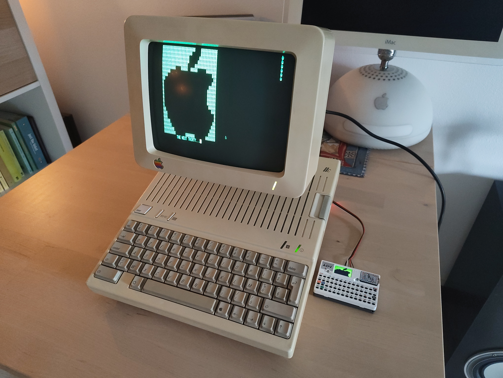
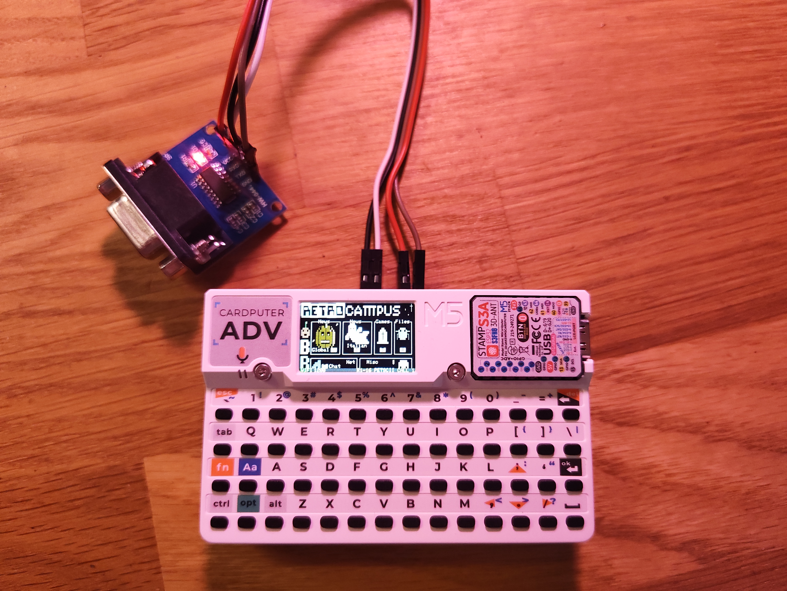

# Zimodem for M5Stack Cardputer ADV





A fork of [Zimodem](https://github.com/bozimmerman/Zimodem) (Bo Zimmerman's WiFi modem firmware for retro computers) ported to the **M5Stack Cardputer ADV** (ESP32-S3).

The Cardputer becomes a self-contained WiFi modem with its own terminal: the retro computer talks to it through the UART on the Grove port, while the built-in keyboard types AT commands and the display shows everything Zimodem prints, so you can configure WiFi and dial a BBS without a host computer attached.

> **Note:** this port was developed with the help of AI (Claude).

## Features

- Terminal on the 240x135 display: 40x16 window, real-time scrolling, scrollback, status bar (WiFi, baud, call state)
- ANSI colors and basic cursor/erase sequences
- Encodings: **CP437**, **UTF-8** and **PETSCII** (C64 colors, reverse, cursor control, graphic symbols); outside a call PETSCII is shown as plain ASCII so AT commands stay readable
- Optional **80-column** and **25-row** virtual screens, with column-by-column horizontal panning (for C64/BBS screens that draw at absolute positions)
- **Settings menu**: virtual screen, text color, UART RX/TX pins, baud rate, UART input on/off, encoding. Stored in NVS
- **Phonebook** with 10 BBS entries (name + `host[:port]`), stored in NVS; selecting an entry types `ATDT host[:port]` for you
- Changing the baud rate in the menu also sends `AT&W`, so Zimodem keeps it across reboots
- Keyboard, display and UART are handled by a dedicated FreeRTOS task, so the screen stays responsive during long Zimodem operations

All Cardputer-specific code lives in `CardputerModemSerial.h`; it replaces Zimodem's `HWSerial` object. Defining `ZIMODEM_CARDPUTER` in `zimodem.ino` enables it; comment that line out to get the stock behaviour.




## Keys

| Key | Action |
|---|---|
| `Fn` + `1` | Settings menu |
| `Fn` + `2` | Phonebook |
| `Fn` + `3` | Cycle encoding: CP437 -> UTF-8 -> PETSCII |
| `Fn` + `` ` `` | Esc |
| `Fn` + `Up`/`Down` | Scrollback (repeats when held) |
| `Fn` + `Left`/`Right` | Pan 1 column (80-column mode) or scrollback by page |
| `Shift` + `Fn` + arrows | Send arrow keys to the host (`ESC [ A/B/C/D`) |
| `Fn` + `Backspace` | Delete (`ESC [ 3 ~`) |
| `Ctrl` + letter | Control code |

The same key that opens the menu or the phonebook also closes it (`Esc` works too). The Cardputer arrows are `;` `.` `,` `/` on the Fn layer.

**Phonebook:** `Up`/`Down` select a slot, `Enter` dials it, `Tab` edits it (type the name, `Tab`/`Up`/`Down` switch field, `Enter` saves, `Esc` cancels). Dialing is refused if a call is already open. Dial from an empty command line, since the text is typed into Zimodem's input.

## Wiring

Default UART pins: **G13 = RX, G14 = TX**; both can be changed in the settings menu. Connect to the retro computer through a level shifter (e.g. a MAX232 for RS-232 serial ports); the ESP32 is 3.3 V only. The RX pin has the internal pull-up enabled.

## Building

Built with PlatformIO using the [pioarduino](https://github.com/pioarduino/platform-espressif32) platform (arduino-esp32 3.x). Libraries used: M5Cardputer, M5Unified, M5GFX and IRremote. See `platformio.ini` for the settings used (board `esp32-s3-devkitc-1`, 8 MB flash). The library entries under `lib_deps` are the standard registry names; if resolution fails, place the libraries in `lib/` instead.

```
pio run -e cardputer-adv -t upload
```

## Files changed from upstream Zimodem

- `CardputerModemSerial.h` (new): terminal, keyboard, menus, phonebook
- `zimodem.ino`: Cardputer setup and the baud-rate hook
- `pet2asc.h`, `zbrowser.ino`: use the Cardputer serial object / SD pins
- `proto_kermit.ino`, `proto_xmodem.ino`, `proto_zmodem.ino`, `wifisshclient.ino`: missing return values fixed for the newer compiler

## License

Apache License 2.0, same as Zimodem. Original work copyright 2016-2026 Bo Zimmerman; see the file headers.
