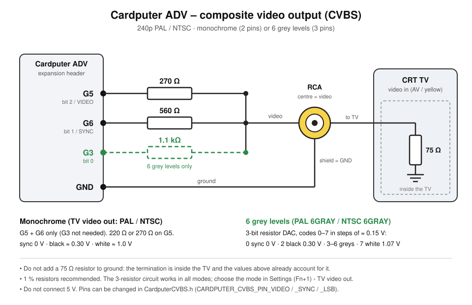

# Zimodem for M5Stack Cardputer ADV


A fork of [Zimodem](https://github.com/bozimmerman/Zimodem) (Bo Zimmerman's WiFi modem firmware for retro computers) ported to the **M5Stack Cardputer ADV** (ESP32-S3).

The Cardputer becomes a self-contained WiFi modem with its own terminal: the retro computer talks to it through the UART on the Grove port, while the built-in keyboard types AT commands and the display shows everything Zimodem prints, so you can configure WiFi and dial a BBS without a host computer attached.

> **Note:** this port was developed with the help of AI (Claude).

## Features

- Terminal on the 240x135 display: 40x16 window, real-time scrolling, scrollback, status bar (WiFi, baud, call state)
- ANSI colors and basic cursor/erase sequences
- Encodings: **CP437**, **UTF-8** and **PETSCII** (C64 colors, reverse, cursor control, graphic symbols); outside a call PETSCII is shown as plain ASCII so AT commands stay readable
- Optional **80-column** and **25-row** virtual screens, with column-by-column horizontal panning (for C64/BBS screens that draw at absolute positions)
- **Settings menu**: virtual screen, text color, UART RX/TX pins, baud rate, UART input on/off, encoding. Stored in NVS
- **BBS phonebook** with 10 entries (name + `host[:port]`), stored in NVS; selecting an entry types `ATDT host[:port]` for you
- **SSH phonebook** with 10 entries (name, user, password, host, optional port), stored in NVS; selecting an entry types `ATDS"user:password@host[:port]"` for you
- Full-screen text apps over SSH (e.g. `mc`, `nano`, `htop`): the SSH session requests `TERM=xterm` with the size of the virtual screen (enable 80 columns / 25 rows in the settings first), and the terminal supports scroll regions, insert/delete line and character, VT100 line drawing, application cursor keys and the alternate screen
- **TV output**: composite video, 240p PAL 50 Hz or NTSC 60 Hz, monochrome or 6 grey levels, showing the whole 80x25 (or 40x16) terminal on a CRT TV. Two GPIOs and two resistors, no extra chips; see *TV output* below
- Changing the baud rate in the menu also sends `AT&W`, so Zimodem keeps it across reboots
- Keyboard, display and UART are handled by a dedicated FreeRTOS task, so the screen stays responsive during long Zimodem operations

All Cardputer-specific code lives in `CardputerModemSerial.h`; it replaces Zimodem's `HWSerial` object. Defining `ZIMODEM_CARDPUTER` in `zimodem.ino` enables it; comment that line out to get the stock behaviour.


## Keys

| Key | Action |
|---|---|
| `Fn` + `1` | Settings menu |
| `Fn` + `2` | Cycle encoding: CP437 -> UTF-8 -> PETSCII |
| `Fn` + `3` | BBS phonebook |
| `Fn` + `4` | SSH phonebook |
| `Fn` + `` ` `` | Esc |
| `Fn` + `Up`/`Down` | Scrollback / move the 16-row window over the 25-row screen (repeats when held); the window then stays where you put it until you type a normal key |
| `Fn` + `Left`/`Right` | Pan 1 column (80-column mode) or scrollback by page |
| `Shift` + `Fn` + arrows | Send arrow keys to the host (`ESC [ A/B/C/D`) |
| `Alt` + arrow keys | Same as above, repeats when held, and does not move the scrolled view (useful in `mc`, `nano`) |
| `Alt` + `1`..`9`, `0`, `-`, `=` | F1..F12 (C64 F1..F8 in PETSCII) |
| `Alt` + other key | `Esc` prefix + key (Meta) |
| `Fn` + `Backspace` | Delete (`ESC [ 3 ~`) |
| `Ctrl` + letter | Control code |

The same key that opens the menu or the phonebook also closes it (`Esc` works too). The Cardputer arrows are `;` `.` `,` `/` on the Fn layer.

**Phonebooks:** `Up`/`Down` select a slot, `Enter` dials it, `Tab` edits it (type each field, `Tab`/`Up`/`Down` switch field, `Enter` saves, `Esc` cancels). Dialing is refused if a call is already open. Dial from an empty command line, since the text is typed into Zimodem's input.

In the SSH phonebook the fields are name, user, password, host and port (empty = port 22). The password is masked unless its field is being edited, but it is stored unencrypted in the Cardputer's flash. Characters that would break the dial string are not accepted: space, `@`, `"` and `,` in the user and password, plus `:` in the user and host. Note that `ATDS"host:port"` (no user) opens a TLS connection, not SSH.


## Wiring

Default UART pins: **G1 = RX, G2 = TX**; both can be changed in the settings menu. Connect to the retro computer through a level shifter (e.g. a MAX232 for RS-232 serial ports); the ESP32 is 3.3 V only. The RX pin has the internal pull-up enabled.

## TV output

Enable it in the settings menu (**TV video out**: OFF / PAL / NTSC / PAL 6GRAY / NTSC 6GRAY). The TV shows the live terminal (all virtual columns and rows); 40 columns are drawn with double-width pixels. Text rows are 8 lines high, like the display (25 rows = 200 of the 240 lines); `CARDPUTER_CVBS_ROW_H 9` gives 9-line rows (225 lines).

**TV calibration** (menu item below *TV video out*): the TV shows a frame around the 80x25 text area with marks every 10 columns and 5 rows; `;` `.` `,` `/` move the picture, `-` / `=` make it narrower / wider by changing the pixel clock (8.89, 9.23, 10.00, 10.91 or 11.43 MHz: only clocks with an integer divider, since fractional ones make the pixels uneven; the line timing is recomputed for each clock). The values are saved with the other settings.

Codes into 75 ohm: 0 sync (0 V), 2 black (0.30 V), 3-6 greys (0.45-0.92 V), 7 white (1.07 V). Each terminal colour becomes one of the 6 levels by brightness (two different colours always at least 2 levels apart). With 270 R on G5 the monochrome modes still work, so the same circuit serves both. The calibration screen shows a 6-step grey ramp in grey mode. G3 is used only in grey mode (`CARDPUTER_CVBS_PIN_LSB`).



How it works: the ESP32-S3 LCD peripheral streams one byte per pixel (10 MHz by default) from two one-line DMA buffers; the sync pulses are part of the data, and an interrupt renders each line from the terminal's character buffer just before it is sent (`CardputerCVBS.h`).


## Building

The `zimodem/` folder is the complete sketch (all Zimodem sources plus the Cardputer files, with the bundled libssh2 in `zimodem/src/libssh2`).

**Arduino IDE:** open `zimodem/zimodem.ino`, install the M5Stack board package (the port was tested with version 3.3.9) and the M5Cardputer library with its dependencies (M5Unified, M5GFX), select the Cardputer board and upload.

**PlatformIO:** uses the [pioarduino](https://github.com/pioarduino/platform-espressif32) platform (arduino-esp32 3.x), board `esp32-s3-devkitc-1`, 8 MB flash; see `platformio.ini`. Libraries: M5Cardputer, M5Unified, M5GFX and IRremote. The `lib_deps` entries are the standard registry names; if they don't resolve, put the libraries in `lib/` instead.


```
pio run -e cardputer-adv -t upload
```

## Files changed from upstream Zimodem

- `CardputerModemSerial.h` (new): terminal, keyboard, menus, phonebook
- `zimodem.ino`: Cardputer setup and the baud-rate hook
- `pet2asc.h`, `zbrowser.ino`: use the Cardputer serial object / SD pins
- `CardputerCVBS.h` (new): composite TV output
- `zpppmode.ino`, `zslipmode.ino`: take the lwip TCP/IP core lock around netif calls (otherwise AT+PPP / AT+SLIP reboot on arduino-esp32 3.x)
- `wifisshclient.ino`/`.h`, `src/libssh2/` (`libssh2_priv.h`, `channel.c`, `libssh2.h`): smaller libssh2 buffers (the session went from 54 KB to 27 KB) and a NULL check, because the Cardputer cannot allocate a 54 KB block once the terminal buffers are in RAM
- `proto_kermit.ino`, `proto_xmodem.ino`, `proto_zmodem.ino`, `wifisshclient.ino`: missing return values fixed for the newer compiler


## License

Apache License 2.0, same as Zimodem. Original work copyright 2016-2026 Bo Zimmerman; see the file headers.
